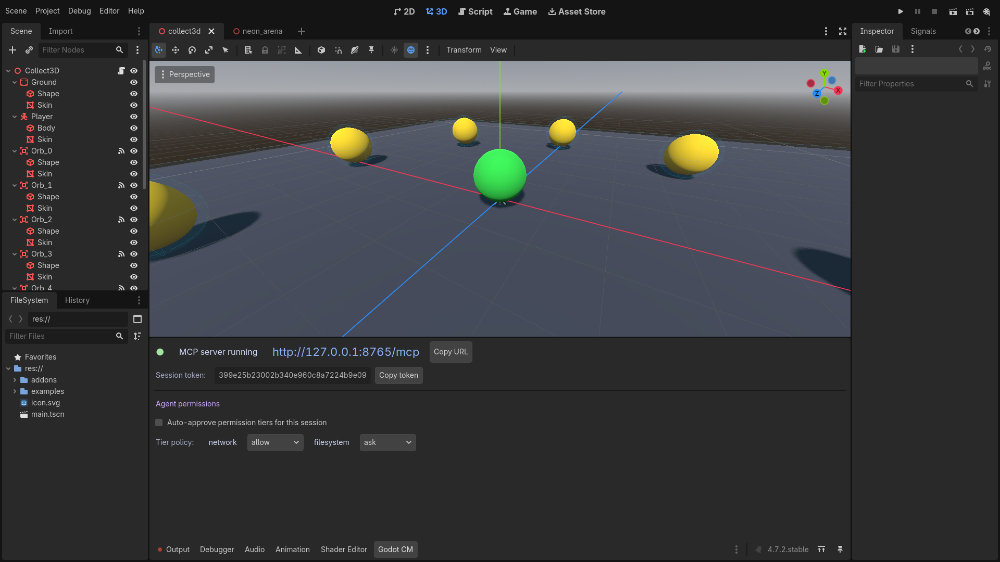

# godot-code-mode

MCP "code mode" for the Godot editor: two tools (`search`, `execute`) backed by a
bounded QuickJS-NG runtime inside a GDExtension addon. Agents write JavaScript
that awaits authorized editor operations. Supported edits can be grouped into
one undoable editor action; an explicit `untracked` mode also permits calls
whose effects cannot be rolled back.

- Current addon version: **0.3.2** — [release notes](CHANGELOG.md)
- Godot floor: **4.7** (validated on 4.7.2, linux-x86_64)
- Platforms: Linux x86-64 tested; Windows x86-64 cross-built, runtime unverified.
- MCP spec: **2025-11-25** (Streamable HTTP on loopback + stdio adapter)
- License: **MIT** (see `LICENSE`; bundled components in
  `addons/godot_cm/THIRD_PARTY_LICENSES.txt`)



## Install into a project

**From the Asset Library** — install, then enable **Godot Code Mode** in
Project → Project Settings → Plugins.

**Manual** — copy `addons/godot_cm/` into your project's `addons/` folder and
enable the plugin the same way (a symlink works for development).

```
your-project/
└── addons/godot_cm/
    ├── godot_cm.gdextension      # entry symbol + per-platform binaries
    ├── plugin.cfg / plugin.gd    # EditorPlugin that owns the service
    ├── bin/                    # native core (.so linux, .dll windows)
    ├── tools/godot_cm_stdio.*  # stdio adapter for MCP clients (Python 3 / Node.js)
    ├── allowlist.json            # permission config: denylist, tiers, policies
    ├── api-surface.d.ts          # generated declarations for the exposed API
    ├── extension_api.json        # 4.7.2 reference dump; discovery uses ClassDB
    ├── LICENSE
    └── THIRD_PARTY_LICENSES.txt
```

When the plugin is active the editor serves MCP on `http://127.0.0.1:8765`
(loopback only, per-session bearer token written to
`user://godot_cm_session` — the adapter reads it, clients never see it on argv).
Set `GODOT_CM_PORT` before launching the editor to change the port; the
adapter reads the same variable.

Permissions are a **denylist**: every engine class is exposed except platform
escape paths (raw `OS`, `Script`, `Engine`, threading, capture devices, and
meta-methods like `call`/`set`/`emit_signal` that would bypass checks). Border
areas live in unlockable **tiers** — `network` (sockets, HTTP, multiplayer
peers) and `filesystem` (FileAccess, DirAccess, resource importers). Each tier
has a policy settable per session in the panel or in `allowlist.json`:
`allow` grants `godot.requestTier()` instantly, `ask` shows a confirmation
dialog, `deny` refuses silently. See `allowlist.json` comments for the full
schema.

## Client configuration

HTTP-capable clients can point at the loopback URL with the session token.
For stdio-only clients use the adapter shipped inside the addon. Two
equivalent implementations are provided — use whichever runtime the client
machine already has (no external dependencies):

- `addons/godot_cm/tools/godot_cm_stdio.py` (Python 3)
- `addons/godot_cm/tools/godot_cm_stdio.js` (Node.js)

**Claude Code**

```
claude mcp add godot-cm -- python3 your-project/addons/godot_cm/tools/godot_cm_stdio.py
# or:
claude mcp add godot-cm -- node your-project/addons/godot_cm/tools/godot_cm_stdio.js
```

**Codex / other stdio clients** — register an equivalent stdio command:

```
python3 your-project/addons/godot_cm/tools/godot_cm_stdio.py
# or:
node your-project/addons/godot_cm/tools/godot_cm_stdio.js
```

**Claude Desktop** — it only accepts stdio servers, so point it at the
adapter. Edit `claude_desktop_config.json`
(`%APPDATA%\Claude\` on Windows, `~/Library/Application Support/Claude/` on
macOS):

```json
{
  "mcpServers": {
    "godot-cm": {
      "command": "python3",
      "args": ["C:/path/to/your-project/addons/godot_cm/tools/godot_cm_stdio.py"]
    }
  }
}
```

Use `node` + `godot_cm_stdio.js` instead if the machine has Node but not
Python. On Windows you can use `"command": "py"` when `python3` is not on
PATH. Restart Claude Desktop after saving.

**Cursor / VS Code / Windsurf** — these accept remote HTTP MCP servers.
Register the editor endpoint directly, e.g. in `.cursor/mcp.json` or the
client's MCP settings:

```json
{
  "mcpServers": {
    "godot-cm": { "url": "http://127.0.0.1:8765/mcp" }
  }
}
```

No adapter or token handling needed in that case — the client talks
Streamable HTTP to the editor and gets the session id from the response
headers.

The adapter forwards stdin/stdout JSON-RPC to the HTTP endpoint, attaching
the token it reads from the session file. It polls for the session file
while the editor starts (`GODOT_CM_TOKEN_WAIT`, 20 s default), retries
stale tokens from other projects, and accepts `GODOT_CM_PROJECT` to pin
one project when several editors are open.

## Tools

| Tool      | Purpose                                                    |
|-----------|------------------------------------------------------------|
| `search`  | Run JS against the immutable API index (`api.*` only)      |
| `execute` | Run JS with `api.*` + `godot.*` (`read`, `write`, `untracked`) |

The catalog reflects the running editor: native engine/GDExtension classes,
singleton aliases, registered project-script classes, and loaded anonymous
scripts encountered through the bridge or edited scene trees. `api.classes()`,
`api.find()` and `api.describe()` share a permission-filtered snapshot per call.
Discovery never loads or instantiates an uncached script: these entries carry
`metadata_status:"class_only"` until explicitly loaded. Cached script members,
paths, source, constructor mode and member execution modes are described too.
Godot's own rules still apply, including tool-script and signature requirements.
Member type descriptors retain `variant_type`, `class_name`, `usage`, `hint`,
`hint_string` and available `element_type` or `key_type`/`value_type` constraints.
Method arguments include their zero-based `index`, declared defaults and vararg
status. `Variant` or unavailable metadata does not imply a concrete conversion
context: `{x:1,y:2,z:3}` remains a dictionary there unless explicitly tagged.
Discovering a class or its parameter types does not authorize constructing or
calling it; the execution mode and permission tiers are checked separately.

Inside `execute`: `godot.editor.getEditedScene()`, `godot.create(cls, ...args)`,
`godot.getSingleton(name)`, `godot.get/set(handle, prop, v)`,
`godot.call(handleOrStaticClassName, method, ...args)`,
`godot.batch([{op, ...}])`, `godot.saveScene()`, `godot.unlockWrites()`.
All `godot.*` calls return promises resolved on the editor main thread; await
all operations before returning.

| Mode | Contract |
|------|----------|
| `read` | Queries and methods/accessors declared const by the native API. |
| `write` | Supported engine-property edits and calls with known inverses, journaled as one editor Undo action; errors trigger rollback. Unknown inverses still return `NO_UNDO`. |
| `untracked` | Generic native/project-script execution after granting the separate `untracked` tier. No transaction, Undo action or rollback is promised. |

For example, first use `execute` in `read` mode to request authorization:

```js
return await godot.requestTier("untracked");
```

After approval, use another `execute` with `mode:"untracked"`:

```js
const editor = await godot.getSingleton("EditorInterface");
await godot.call(editor, "play_current_scene");
```

No plugin-specific adapter or registration is required. Unknown native/plugin
mutations, script calls/constructors/accessors and callbacks with unknown effects
use `untracked`; they are not classified as safe just because their names start
with `get_` or `is_`. Direct class/member restrictions, filesystem/network tiers
and the write lock still apply, including to batches. Invoked plugin/project
code is trusted code, not a filesystem/network sandbox: the `untracked` approval
explicitly covers its arbitrary side effects.

Responses include `mode`, `rollback_supported`, `effects` and `partial`.
On an `untracked` failure, effects may already have occurred; inspect state
before retrying. `effects` records attempted/dispatched non-reversible operations,
not a guarantee that a plugin completed its domain operation successfully.
JavaScript cancellation cannot preempt a running native method. The bridge waits
for in-flight native calls to settle before reporting their effects; if the outer
worker deadline expires first, `outcome:"unknown"` is returned instead.

Known mathematical destinations accept named fields, or explicit tags such as
`{$t:"Vector3",x:1,y:2,z:3}`. Missing, extra and incompatible components fail
before assignment/invocation. Positional arrays are not mathematical inputs.
`Variant`/untyped destinations preserve ordinary objects as dictionaries;
use `$t` to express a different type there. Color requires RGB; omitted alpha
is 1. HDR/negative channels are not clamped or converted to another color space.
Integers must be safe JavaScript Numbers, signed-64 BigInts, or canonical decimal
`{$t:"int",value:"9223372036854775807"}` values. Large integer outputs keep that
tag. Special scalar floats use `{$t:"float",value:"NaN"}` with `NaN`,
`+Infinity`, `-Infinity` or `-0`. Mathematical outputs have their concrete tags;
native mathematical values with non-finite components remain opaque references.
Packed inputs accept ordinary arrays in a known destination or explicit forms
such as `{$t:"PackedByteArray",values:[0,1,255]}`. Non-JSON/large values may be
opaque `__godotValue` references that can be passed back as arguments/properties.
Data transport rejects active accessors/toJSON hooks, proxies, functions,
symbols, sparse arrays, nested undefined, cycles and strings that Godot cannot
represent without loss. It does not execute those hooks to obtain data.

The worker reserves intrinsic `Error.prepareStackTrace=undefined` and
`Error.stackTraceLimit=32` as non-writable/non-configurable properties. These
worker-local restrictions keep diagnostic generation passive; they do not
change bridge permissions or the user's project.

Rotation units belong to the Godot property, not to Vector3. For example:

```js
await godot.set(node, "rotation_degrees", {x:0,y:90,z:0});
await godot.set(node, "rotation", {x:0,y:Math.PI/2,z:0});
await godot.set(node, "quaternion", {x:0,y:0,z:0,w:1});
await godot.set(node, "basis", {
  x:{x:1,y:0,z:0}, y:{x:0,y:1,z:0}, z:{x:0,y:0,z:1}
});
await godot.set(node, "transform", {
  basis:{x:{x:1,y:0,z:0}, y:{x:0,y:1,z:0}, z:{x:0,y:0,z:1}},
  origin:{x:1,y:2,z:3}
});
```

`rotation` uses radians, `rotation_degrees` uses degrees; neither is converted
by the codec. `rotation_order` remains the node's Euler order. `basis`,
`quaternion` and `transform` use their own concrete types; Vector4 is not a
Quaternion. Basis/Projection axes are columns. Transform2D has `x`, `y`,
`origin`; Transform3D has `basis`, `origin`. The codec does not transpose,
normalize or invent identity components. Local/global properties keep their
Godot meanings; Godot setters can still enforce their own domain semantics.

Unlike 0.2.1, StringName and NodePath outputs preserve identity as
`{$t:"StringName",value:"name"}` and `{$t:"NodePath",value:"path"}` rather than
bare strings. Use `.value` when text is needed. Re-sending the tag to a Variant
parameter preserves the concrete type; NodePath transport does not resolve nodes.

Object references include their native `class_name` and, when applicable,
`script_class`; use that symbol with `api.describe()` or `godot.create()`.
Unknown allocator methods may return caller-owned orphan nodes; adopt/free
them explicitly rather than expecting the bridge to delete borrowed objects.
Set `GODOT_CM_GENERATE_DTS=1` to write runtime declarations to
`user://godot_cm-api-surface.d.ts`; normal activation skips generation. The
`GodotClass_*` interfaces describe reflected signatures, not callable JavaScript
globals. Use `godot.call` to invoke an authorized class or object. Metadata
`default_status:"unavailable"` distinguishes an unrepresentable default from a
known null default; the native invocation still applies its own omitted defaults.

### Collections and retained values

Use `search` with `return api.types()` or `return api.describeType("Basis")`
for the 39-type inventory, component schemas, formats and limits. Discovery
never grants execution rights or loads a script to complete a type.

Collections of at most **256 elements and 16 KiB encoded** can be inline.
Packed collections use `{$t:"PackedStringArray",values:["one","two"]}`;
typed arrays retain `element_type`, and typed dictionaries retain
`key_type`/`value_type`. Larger, deep or cyclic native collections use opaque
`{__godotValue:"...",type:"..."}` references. These are **not object handles**:
calling `godot.get/call` on one produces `REFERENCE_KIND_MISMATCH`.

```js
const info = await godot.values.inspect(valueReference);
const page = await godot.values.read(valueReference, {offset:0, limit:64});
return {info, page};
```

Pages have `type`, `offset`, `count`, `total`, `next_offset` and `truncated`,
plus `items`, dictionary `entries`, or mathematical `fields`. Text references
page Unicode characters in `items`. Defaults are offset 0 and limit 64; limits
are 1..256, with at most 16 KiB per encoded page. A large element can itself
be a retained reference. RID/Callable/Signal expose passive metadata only;
reading unsupported structure reports `UNSUPPORTED_VALUE_OPERATION`, without
invoking a callback, getter or signal. The received `type` label is advisory:
actual identity and compatibility come from the server registry.

Retained values survive executions within the current service generation.
Restarting the service invalidates old object/value identifiers. Quotas are
**4096 retained values and 64 MiB of accounted storage**, with no silent
eviction. Accounting is a bounded recursive estimate at retention, not a live
heap/GPU measurement; shared payloads can be counted more than once and mutable
values can subsequently change. Exhaustion reports `VALUE_REFERENCE_LIMIT`.
`await godot.values.release(ref)` requires authorized `untracked` mode and
invalidates only that reference, not aliases. It never explicitly frees a
borrowed object, but final refcount cleanup can have effects and cannot be undone.
Retained typed collections keep native restrictions; an opaque untyped
collection does not acquire a narrower type by changing its client label.

For non-string or reserved dictionary keys, use the literal entries form:

```js
const data = {$t:"Dictionary", entries:[
  {key:"$t", value:"literal data"},
  {key:"__godotValue", value:"not a reference"},
  {key:1, value:"integer key"}
]};
```

The resulting dictionary is not interpreted again as an envelope. String key
`"1"` does not become integer key `1`; duplicate keys after contextual conversion
are rejected rather than overwritten.

### Diagnostics and checkpoints

Errors retain codes such as `TYPE_MISMATCH`, `INVALID_HANDLE`,
`INVALID_VALUE_REFERENCE`, `PERMISSION` and `UNAWAITED_VALUE`, with available
`operation`, `class`, `member`, `argument`, `path`, `expected`, `received`,
`batch_index` and `source:{line,column,stack}`. Locations refer to submitted JS;
unavailable locations are omitted. `path:"value.y"` identifies a bad component,
not a recovered local variable. No automatic argument or local-variable dump is
included. A successful native invocation does not prove plugin-domain success.

```js
const position = await godot.get(node, "position");
checkpoint("before", position);
await godot.set(node, "position", {x:1,y:"bad",z:3});
```

`checkpoint(name,value)` is **synchronous**, unlike the asynchronous `godot.*`
operations. Responses retain ordered `{name,value}` snapshots even after failure;
repeated names append rather than replace entries. Limits: 32 entries, 1..128
UTF-8 bytes per name, 64 KiB for the encoded checkpoint list including its JSON
envelopes, and value depth 32. `CHECKPOINT_LIMIT` leaves prior entries intact.
Capture is passive: no getters, promises, cycles or active formatters. References
remain references, not copies of live scene state. Nothing is written to files
or retained in the next execution.

`result` is the final returned value, or null for void/no final result;
`checkpoints` are historical observations; `effects` records dispatched
untracked operations. Checkpoints alone do not set `partial:true` or create Undo
actions. A checkpoint before rollback is not rewritten into post-rollback state.
A recorded handle can later expire. Await nested operations before capturing or
returning their values; returning a bridge promise directly remains valid.

The execution envelope before MCP wrapping is bounded to 256 KiB. `truncated`,
`result_omitted`, `effects_omitted`, `changes_omitted`, `diagnostics_omitted` and
metadata omission counts identify incomplete data. The primary error and
completed checkpoints are retained; an effect prefix is not a complete history.
Higher-level helpers: `godot.build({type,name,props,children},{parent})`,
`godot.scene.new/reload/tree/run/stop`, `godot.attachScript(node,'res://x.gd')`,
`godot.permissions({class,member})`, `api.example(type)`.
Responses are compact by default: empty fields are omitted and writes are
summarized as `changes: {counts: {"Class.op": n}, total, status}` — pass
`verbose: true` on the tool call for the ordered per-op log.

`godot.batch` applies a list of ops in **one** main-thread dispatch and
resolves with ordered per-element results — the fast path for op-dense
scripts (see `docs/benchmarks.md`).

Default cooperative budgets: 5 s for read and 60 s for write/untracked (adjust
via `timeoutMs`), 32 MiB JS heap, 1,000 operations and a 256 KiB execution
envelope before MCP wrapping. Native methods cannot be forcibly interrupted.

## Performance and verification

Version 0.3.1 reuses catalog metadata with freshness checks, constructs bounded
pages without repeatedly encoding their prefixes, and avoids a redundant JSON
parse for compatible passive worker results. Permissions, codec validation,
quotas, request isolation and single-dispatch batch semantics are unchanged.

In the isolated minimal-topology comparison against 0.3.0, median latency fell
from **263.4 to 6.8 ms** for 100-read batches, **1294.6 to 20.9 ms** for
500-read batches, and **14.0 to 6.7 ms** for 256-element pages. The primary
matrix includes 21,600 measured samples across three topologies and three
alternating rounds. These are workload-specific measurements, not an SLA.

There are trade-offs: median direct startup increased from **704.5 to 798 ms**,
and conservative reconciliation can make unknown-effect/script calls slower.
Single operations and small pages have no general speedup claim. A native call
can still block beyond the cooperative budget; batches are not split across
frames. See [benchmarks](docs/benchmarks.md) for raw-report locations, binary
identities, p95, rendered-editor tests, limitations and reproduction commands.

Development profiling is opt-in via `GODOT_CM_PROFILE=1` when launching Godot.
It emits fixed aggregate counters/timings on the process output, not new MCP
fields or tools. It excludes submitted code, argument/result contents,
credentials, project paths and object identifiers. Profiling has overhead;
leave it disabled for normal use and primary latency comparisons.

After building, run the isolated integration suite and harness tests:

```bash
python3 -B tools/test_generic_bridge.py
python3 -B -m unittest discover -s tools -p test_bridge_benchmark.py -v
```

Tests create temporary projects rather than opening the example project. The
release passes Linux integration, all 39 Variant fixture categories, nineteen
harness tests and TypeScript declaration checks. Windows build success does not
establish Windows runtime compatibility. See [AGENTS.md](AGENTS.md) for catalog
lifetime tests, declaration checks and the complete verification commands.

## Build

Linux (host build):

```
cmake -B build -DGODOTCPP_TARGET=editor -DCMAKE_BUILD_TYPE=Release
cmake --build build -j 6
```

Windows cross-compile (MinGW-w64 toolchain installed):

```
cmake -B build-windows -DCMAKE_TOOLCHAIN_FILE=toolchains/mingw-w64.cmake \
    -DGODOTCPP_TARGET=editor -DCMAKE_BUILD_TYPE=Release
cmake --build build-windows -j 6
```

Output lands directly in `addons/godot_cm/bin/` (`.so` / `.dll`). The
Windows build statically links the MinGW runtime, so separate MinGW runtime
DLLs are not needed; Windows system libraries are still required. `godot-cpp/`
is a submodule compiled against the project's `api/extension_api.json` (dumped
from Godot 4.7.2).
